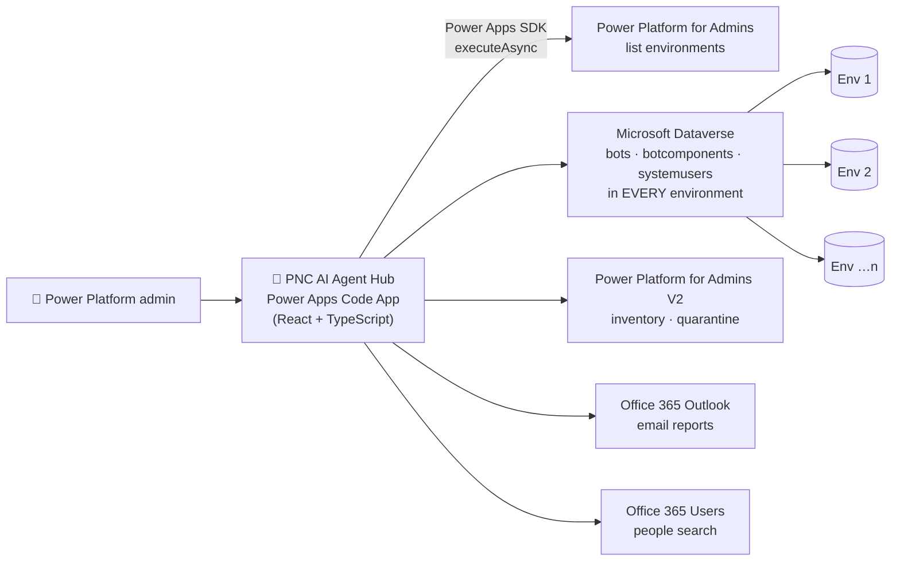
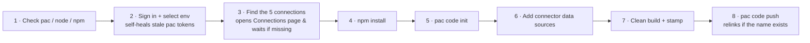
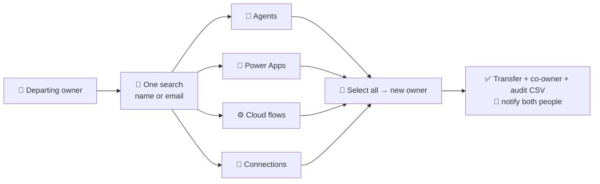

<div align="center">

# 🤖 PNC AI Agent Hub

### Every AI agent in your Microsoft tenant — found, mapped, scored and governed from one screen.

**Copilot Studio · Agent Builder (Copilot lite) · Child agents · Connected agents · Classic V1 · Flows**


</div>

---

> **The problem:** AI agents are multiplying faster than anyone can track them. Makers build Copilot Studio agents, business users spin up Agent Builder agents in Microsoft 365 Copilot, agents call other agents, and child agents hide *inside* parents where no admin screen shows them. Security teams can't answer the basics: *How many agents do we have? Who owns them? What can they touch? Which ones are exposed?*
>
> **The answer:** PNC AI Agent Hub scans **every environment in the tenant** in one click and turns the result into an inventory, a relationship map, a risk register and an action console — with **zero app registrations, zero Azure resources, zero consent grants.** It runs entirely on the signed-in admin's own Power Platform connections.

---

## 📑 Contents

- [✨ Feature tour](#-feature-tour)
- [🏗 Architecture](#-architecture)
- [🔍 How detection works](#-how-detection-works)
- [🚀 Deploy in one command](#-deploy-in-one-command)
- [🔌 Connections](#-connections)
- [📊 Reports & exports](#-reports--exports)
- [❓ FAQ](#-faq)
- [🧠 Lessons learned](#-lessons-learned)
- [🗺 Roadmap — Power Platform Command Center](#-roadmap--power-platform-command-center)
- [📁 Project structure](#-project-structure)

---

## ✨ Feature tour

### 🔎 Discover — the whole tenant, every agent type

| | Feature | What it does |
|---|---|---|
| 🌐 | **One-click tenant scan** | Walks every Dataverse environment (3 in parallel) and reads `bots` + `botcomponents`, plus the Power Platform inventory API for tenant-wide truth. |
| 🤖 | **Copilot Studio (full) agents** | Modern agents — generative or classic orchestration — with instructions, tools, knowledge and triggers. |
| 🪶 | **Agent Builder (Copilot lite)** | Agents built in Microsoft 365 Copilot, detected from the inventory `createdIn` field, the `gpt*` template, or the *Microsoft 365 Copilot Chat* environment — including ones only the inventory can see. |
| 🧒 | **Child agents** | Agents that live *inside* a parent (stored as `kind: AgentDialog` topics) — invisible in most admin views. |
| 🔗 | **Connected agents** | Separate agents invoked by another agent (`InvokeConnectedAgentTaskAction`). |
| 🗿 | **Classic (V1) bots** | Legacy Power Virtual Agents bots — flagged for migration. |
| ⚙️ | **Flows** | Every cloud flow from the tenant inventory, with resolved owners. |
| 🌐 | **Environment search** | Environment names load on start-up; type to filter, or **⚡ Scan N matching envs** to scan just those. |
| 🆔 | **Find by ID** | Paste a bot ID, child-agent ID, flow ID, schema name or a Copilot Studio URL → instantly told whether it's a 👑 parent, 🧒 child, 🔗 connected, 🪶 lite, 🤖 full agent, 🗿 classic or ⚙️ flow. Not in the scan? It searches **every environment live**. |

### 🗺 Understand — see how it all fits together

| | Feature | What it does |
|---|---|---|
| 🌳 | **Parent ↔ Child tree** | Every parent agent with its child and connected agents, with relationship exports. |
| 🕸 | **Agent Map** | Interactive radial constellation: tenant → environments → agents → sub-agents. Zoom, hover, click-through, pulsing rings on autonomous agents. |
| 🧬 | **Capability graph** (in Details) | Animated diagram of everything an agent uses — 🔌 connectors (with operations), ⚙️ flows, 🧩 MCP servers, ✨ prompts, 🎓 skills, 📚 knowledge, 🧒/🔗 sub-agents, ⚡ triggers, 🌐 HTTP. |
| 🔍 | **Agent detail drawer** | Owner, auth, lifecycle, exposure score, instructions (system prompt, copyable), tools, knowledge and verified console links. |
| ↗ | **Verified console links** | Copilot Studio agents open their own page; child agents open the parent; Agent Builder agents open the Microsoft 365 admin center agent registry (they're hidden from Copilot Studio by design). |
| 👤 | **Owner lookup** | Type a name or email — suggestions appear instantly — and see everything that person owns. |
| 📊 | **Insights** | Agent mix donut, agents per environment, top owners, key numbers. |

### 🛡 Assess — risk, hygiene and sprawl

| | Feature | What it does |
|---|---|---|
| 🎯 | **Agents to Watch** | 0–100 exposure score per agent: no-auth + published, open access policy, autonomous triggers, tools and knowledge breadth, missing/disabled owner, Default environment. Gauges, reasons and ranking. |
| ♻ | **Lifecycle** | Classifies every agent as 🕳 Orphaned · 💤 Dormant · 🧟 Zombie draft · 🕸 Stale · ✏️ Draft · ✅ Active, plus a 12-month *created vs published* growth chart. |
| 🔒 | **Security review** | OWASP LLM / Agentic-aligned findings: excessive agency, missing auth, no guardrail prompt, unreviewed agents, legacy bots. |
| 🔌 | **Connector Atlas** | Every connector used by every agent, tiered **High / Custom / Medium / Low** from Microsoft's DLP guidance, with a 🔒 badge on connectors DLP **cannot block**. Drill into who uses what. |
| 👯 | **Sprawl detector** | Finds 👯 twin and 🧬 sibling agents (normalised names, instruction shingles, tool-set overlap, union-find clusters) so you can consolidate. |
| 🔄 | **Delta** | "Since last scan: N new, M removed", with NEW badges on fresh agents. |

### ⚡ Act — don't just report, fix

| | Feature | What it does |
|---|---|---|
| ⛔ | **One-click quarantine** | Quarantine or release an agent from the Details drawer (Power Platform for Admins V2). |
| 📨 | **Owner recertification** | An access review for AI agents: each owner gets one email listing their agents and replies **KEEP / RETIRE** by a deadline. Test-send to yourself first; a tracker CSV records the answers. |
| 📧 | **Email any report** | Every tab emails as CSV + PDF with a people picker (directory search as you type). |
| 🗓 | **Schedule** | One click creates a weekly calendar reminder to rescan and report. |
| ⟳ | **Auto-rescan** | Optional 15-minute refresh while the app is open. |

### 🎨 Experience

🌙 / ☀️ dark & light mode · PNC orange & navy branding with logo slots · animated hub logo · ★ pinned agents · sortable, searchable tables · responsive layout.

---

## 🏗 Architecture



**Why connectors, not MSAL?** Code Apps run in a sandboxed iframe whose content security policy blocks direct calls to Entra ID, Graph and Dataverse. Instead of fighting the CSP with an app registration, every call goes through the Power Apps host using the signed-in user's **own connections** — so permissions are exactly what that admin already has, nothing more.

Operation and parameter names are discovered at runtime from the pac-generated connector schema, so connector schema changes don't break the app.

---

## 🔍 How detection works

| Agent type | Signal (verified against Microsoft Learn & real tenants) |
|---|---|
| **Copilot Studio (full)** | `bot` with any V2 component (types 9–20), or template `default-2.*` / `cliagent-*` |
| **Agent Builder (lite)** | inventory `createdIn` = *Microsoft 365 Copilot Agent Builder*, or template `gpt*`, or lives in the *Microsoft 365 Copilot Chat* environment |
| **Classic (V1)** | has V1 components (types 0–8) and **no** V2 components |
| **Child agent** | Topic V2 (`componenttype 9`) whose YAML contains `kind: AgentDialog` |
| **Connected agent** | Topic invoking `InvokeConnectedAgentTaskAction` → `botSchemaName` resolved to a bot |
| **Autonomous** | External Trigger component (`componenttype 17`) |
| **Knowledge** | componenttype 14 / 16 |
| **Tools & connectors** | `TaskDialog.action.kind` = `InvokeConnectorTaskAction`, `InvokeFlowTaskAction`, `InvokeExternalAgentTaskAction` (MCP / A2A), `InvokeAIBuilderModelTaskAction`, `InvokeComputerUsingAgentTaskAction` … plus inline `InvokeConnectorAction` / `HttpRequestAction` nodes; connector API parsed from `connectionReference` |
| **Owner** | `_owninguser_value` → `systemusers` (name, email, **disabled** flag); flows by Entra object id |

---

## 🚀 Deploy in one command

**Prerequisites:** [Power Platform CLI (pac)](https://learn.microsoft.com/power-platform/developer/cli/introduction), Node.js 18+, npm, and a Power Platform admin account. No Azure CLI.

```powershell
Set-ExecutionPolicy Bypass -Scope Process -Force; cd C:\agentinventory51b; & .\deploy.ps1
```

The script remembers your environment, then does everything else:



✅ Success looks like `App pushed successfully` and the header in the app shows the same **build** stamp the script prints.

---

## 🔌 Connections

| Connection | Used for | Required |
|---|---|---|
| **Power Platform for Admins** | List every environment in the tenant | ✅ |
| **Microsoft Dataverse** | Read bots, components and users in every environment (premium) | ✅ |
| **Power Platform for Admins V2** | Tenant inventory (Agent Builder truth, flows) + quarantine | ✅ |
| **Office 365 Outlook** | 📧 Email reports and 📨 recertification campaigns | ✅ |
| **Office 365 Users** | 👤 People search as you type | ✅ |

> 💡 Create them at **make.powerapps.com → Connections → + New connection**, signed in as the admin. The deploy script detects them automatically — no IDs to copy.

---

## 📊 Reports & exports

Every tab exports **CSV**, **PDF** and **📧 email**. The inventory CSV carries **41 audit columns**, aligned with Microsoft's Copilot Studio Kit, CoE Starter Kit and the admin center inventory:

<details>
<summary><b>Show all inventory columns</b></summary>

`Agent` · `Agent Role` · `Type` · **`Agent ID`** · `Parent Agent` · **`Parent Agent ID`** · `Relationship` · **`Child Agents [IDs]`** · **`Connected Agents [IDs]`** · `Environment` · `Environment ID` · `Default Environment` · `Owner Name` · `Owner Email` · `Owner Disabled / Orphaned` · `State` · `Status Reason` · `Lifecycle` · `Exposure Score` · `Risk Band` · `Risk Reasons` · `Quarantined` · `End-User Auth` · `Access Policy` · `Orchestration` · `Autonomous Triggers` · `Knowledge Sources` · `Tools / Connectors / Skills` · `Uses MCP` · `Uses HTTP` · `Uses Computer Use` · `Instructions Present` · `Entra Agent ID` · `Template` · `Detected Via` · `Created` · `Modified` · `Days Since Modified` · `Published` · `Schema` · `Open Link`

</details>

PDFs switch to A3 landscape for wide reports, print IDs in monospace so they never wrap, and carry the credit footer on every page. Parent ↔ Child reports include **both** the parent ID and the child / connected agent ID on every row.

---

## ❓ FAQ

<details>
<summary><b>Do I really not need an Entra app registration?</b></summary>

Correct. The app never acquires its own tokens. Every request runs through Power Apps connections owned by the signed-in user, so there's no client ID, no secret, no redirect URI, no admin consent and no CSP change.
</details>

<details>
<summary><b>What permissions does the user need?</b></summary>

A **Power Platform administrator** (or Dynamics 365 admin) role so the connections can read every environment, and a Power Apps license that covers the **premium** Dataverse connector. Users only see what their own role allows.
</details>

<details>
<summary><b>Why does an environment show as "skipped"?</b></summary>

Either it has no Dataverse database (so it can't host agents) or the signed-in admin can't read its `bots` table. The Skipped panel lists the exact reason per environment.
</details>

<details>
<summary><b>Why does "Open" on an Agent Builder agent go to the Microsoft 365 admin center?</b></summary>

Microsoft deliberately hides Agent Builder agents from Copilot Studio, and there's no documented per-agent URL. The app opens **M365 admin center → Agents → All agents** and copies the agent name to your clipboard so you can paste it into search. Backup links to the Power Platform admin center are in the Details drawer.
</details>

<details>
<summary><b>Why is my Agent Builder agent's capability graph empty?</b></summary>

Agent Builder tools and knowledge live in Microsoft 365, not in Dataverse `botcomponents`, so the app can't read them.
</details>

<details>
<summary><b>Does any data leave my tenant?</b></summary>

No. The app talks only to Microsoft connectors in your tenant. The only things stored locally are your theme, pinned agents, the last-scan snapshot for the delta, and recertification history — all in your own browser.
</details>

<details>
<summary><b>How is the exposure score calculated — and is it official?</b></summary>

It's a transparent heuristic (shown as "+N reason" chips), modelled on the Copilot Studio Kit's *Agents to watch* and Agent 365's *agents at risk*. Microsoft doesn't publish an official formula, so treat it as a triage aid, not a verdict.
</details>

<details>
<summary><b>Are the Connector Atlas risk tiers Microsoft's?</b></summary>

The *unblockable* list is Microsoft's (from DLP connector classification docs). High / Medium / Low tiers are derived from Microsoft's DLP strategy guidance (exfiltration-capable connectors such as HTTP, SMTP, FTP, consumer storage and social are High). Adjust them in `src/community.ts` to match your own DLP policy.
</details>

<details>
<summary><b>Does quarantine delete anything?</b></summary>

No. Quarantine stops the agent responding on every channel until it's released. Nothing is deleted, and release is one click.
</details>

<details>
<summary><b>The deploy says "ApplicationDisplayNameIsInUse" — is that bad?</b></summary>

No. The script reads the existing app ID from the error, relinks `power.config.json` and pushes an update to the same app, so the URL never changes.
</details>

<details>
<summary><b>How big a tenant can it handle?</b></summary>

Pages through Dataverse at 5,000 rows per call, scans three environments concurrently, and the Sprawl detector uses an inverted index so it never compares every pair. Large tenants take longer, but you can scope a scan with environment search.
</details>

---

## 🧠 Lessons learned

Hard-won during 60 builds of this app — useful for anyone building Power Apps Code Apps.

**🏛 Architecture**
- **Connectors beat MSAL inside Code Apps.** The Code App iframe's CSP blocks token POSTs to Entra ID and direct Graph / Dataverse calls. Routing everything through `getClient(dataSourcesInfo).executeAsync()` removed the app registration, the consent grants, the redirect URIs and the CSP changes in one move.
- **Discover connector operations at runtime.** Match operation names by pattern against the generated `dataSourcesInfo` and find the body parameter from its schema — far more robust than hard-coding generated service classes.
- **"Classic" is not "no instructions".** Early versions labelled modern agents as Classic because they had no Custom GPT component. The reliable rule is *V1 components and no V2 components* — straight from the `botcomponent` option set.

**🔍 Copilot Studio data model**
- Child agents have **no dedicated component type**; they're Topic V2 rows containing `kind: AgentDialog`.
- Agent Builder agents are **hidden from Copilot Studio by design** — link admins to the M365 admin center registry instead.
- Tool connectors live in `connectionReference: <prefix>.<shared_api>.<id>`; custom connectors encode underscores as `-5f`.

**🛠 Deployment**
- `pac code push` prints success as *"App pushed successfully"* — match loosely, and always scan pac output for `Error:` because it can exit 0 on failure.
- Self-heal stale pac token caches (`ExternalTokenManagement` / *No token cache item*) with `pac auth clear` + `pac auth create`.
- Name collisions: parse `Existing App: '<guid>'`, write it into `power.config.json`, retry.
- Connection creation can't be automated — open the Connections page, list the **exact** connector names, and poll `pac connection list`.
- Match connector API names with a word boundary — `shared_office365` also matches `shared_office365users`.
- Never ship the placeholder `.power` schema in a zip that users extract in place; it overwrites the real one.
- Keep the npm build script plain `vite build`, run pac via `cmd.exe /c`, and stamp every build so you can verify what's live.

**📄 Reporting**
- jsPDF core fonts are WinAnsi-only — arrows and emoji print as garbage, so sanitise PDF text.
- Put IDs in a fixed-width monospace column so GUIDs never wrap.

---

## 🗺 Roadmap — Power Platform Command Center

<div align="center">

### 🛰 Coming next: **Power Platform Command Center**

*One screen to see — and hand over — everything a person owns.*

</div>

The Agent Hub answers *"what agents exist?"*. The Command Center answers the question every admin faces when someone changes role or leaves: **"what do they own, and who takes it over?"**



**Planned capabilities**
- 🔎 **One search, everything owned:** agents, canvas & model-driven apps, cloud flows and connections across every environment.
- 🔁 **Bulk ownership transfer on one screen:** select all → pick the new owner with the people picker → transfer. Optionally keep the old owner as co-owner during hand-over.
- 🕳 **Orphan rescue:** surface everything owned by disabled accounts and reassign it in one pass.
- 🧾 **Audit trail:** before/after owner, timestamp and who ran it — exported as CSV/PDF and emailed to both parties.
- 🛡 **Same promise:** connector-only, no app registration, one-command deploy.

**Also on the list for the Agent Hub:** usage & last-active data from analytics, DLP policy import to colour the Connector Atlas with your *actual* policies, scheduled scans with emailed diffs, and Teams notifications for new high-risk agents.

---

## 📁 Project structure

```text
src/
├─ App.tsx              # UI shell, tabs, exports, email, recertification, ID finder
├─ scanner.ts           # tenant scan, detection rules, live ID lookup, verified links
├─ connectors.ts        # connector-only API layer (runtime operation discovery)
├─ capabilities.ts      # YAML → connectors / flows / MCP / skills extraction
├─ CapabilityGraph.tsx  # 🧬 per-agent capability visualisation
├─ governance.ts        # 🎯 exposure score, ♻ lifecycle, growth
├─ community.ts         # 🔌 Connector Atlas tiers, 👯 sprawl clustering
├─ AgentMap.tsx         # 🕸 tenant constellation
├─ PeoplePicker.tsx     # 👤 instant + directory people search
├─ HubLogo.tsx          # animated logo
└─ styles.ts            # PNC theme, dark / light
deploy.ps1              # one-command, self-healing deploy
branding/               # drop pnc_logo.png / logo_left.png / logo_right.png here
```

---

<div align="center">

### Created by Kirolos • Power of Automation

⭐⭐⭐⭐⭐

**Give it 5 stars if you like it — and want more solutions!**

</div>
